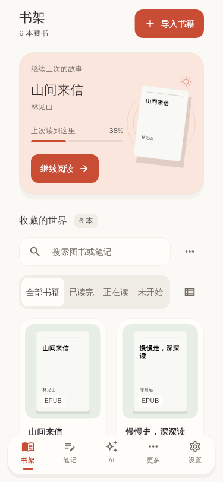
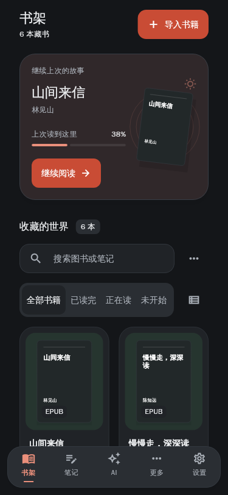
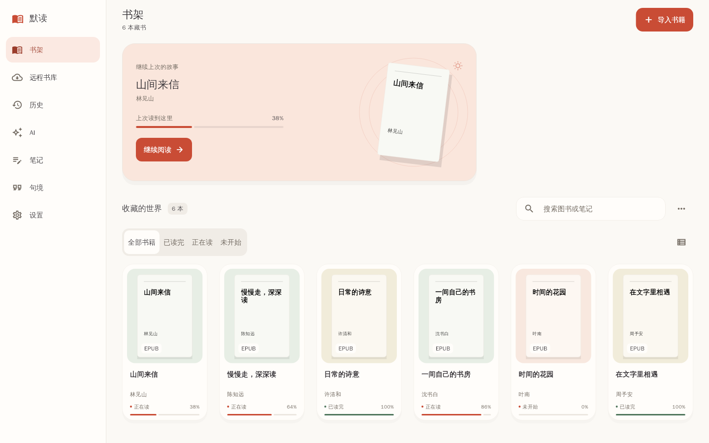
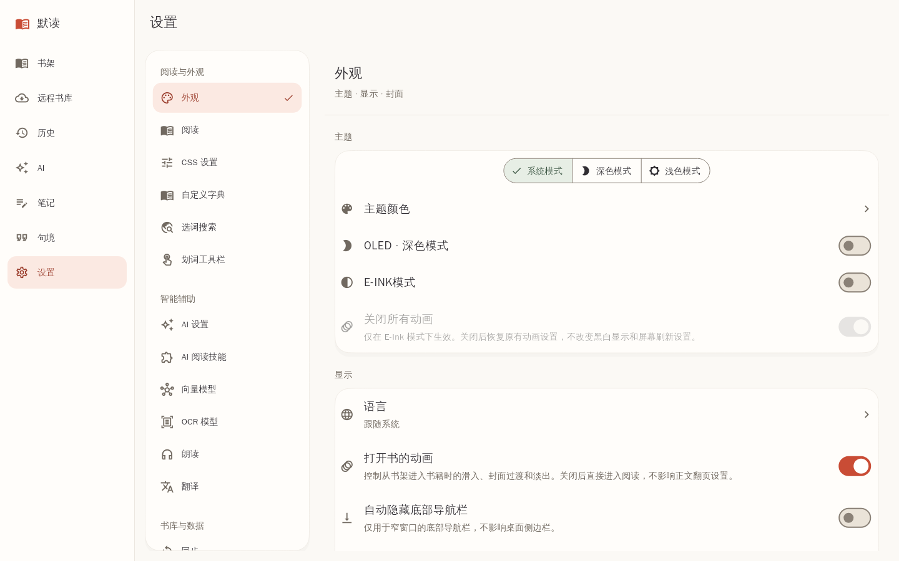
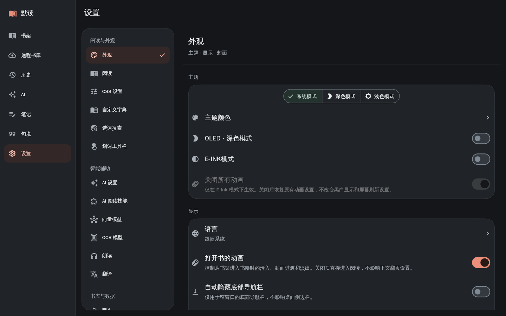
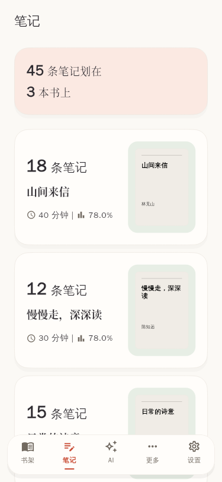
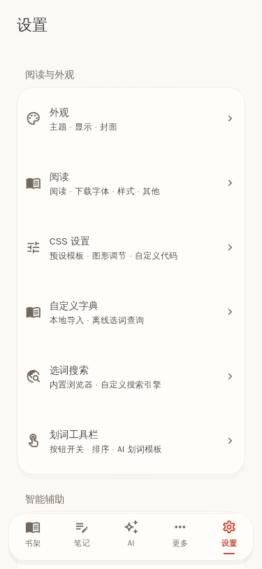
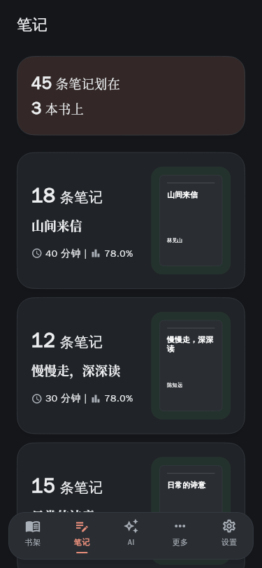
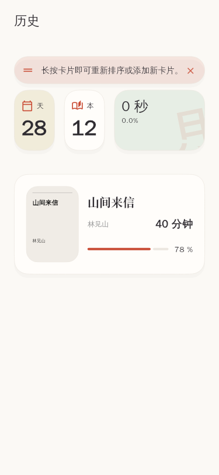
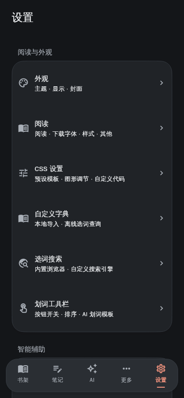

# 默读界面重设计

用户已确认书架的原型风格，现推广到其他页面。奶白背景、珊瑚色操作、白色圆角卡片与局部浅彩色衬底由 [全局规范](../../design-system/modu-reader/MASTER.md) 统一定义；书架专有布局见 [书架规范](../../design-system/modu-reader/pages/bookshelf.md)。原字体和阅读正文的用户设置保留。

## 真实组件预览

使用应用里的书架、笔记、设置、导航与历史统计 / 记录组件渲染；书籍、笔记数量和阅读数据为虚构测试数据。正文使用本机中文字体，实际系统字体依平台略有差异。

| 手机浅色 | 手机深色 |
| --- | --- |
|  |  |







| 手机笔记 | 手机设置 |
| --- | --- |
|  |  |

| 深色笔记 | 历史卡片 |
| --- | --- |
|  |  |



深色模式单独适配为炭灰表面、中性浅色文字与珊瑚红操作按钮；彩色衬底降低饱和度，底栏和弹窗使用较亮一层的灰色。原字体、浅色模式和 OLED 纯黑选项保留。深色书架、笔记及手机 / 桌面设置预览已更新，文字、按钮与彩色表面的对比度检查通过。

## 实现与验证

- 手机最多五个导航入口；远程、历史和句境通过「更多」访问。可选入口开关、AI 弹层、自动隐藏和键盘避让继续生效。
- 桌面侧栏在窄窗口折叠，可滚动以适应横屏和大字号。设置目录按阅读、智能辅助、数据和支持分组；桌面使用紧凑分类目录，将说明移到独立详情标题下。
- 书架页头放置名称、数量和珊瑚色导入按钮。搜索与操作菜单合为一行，放到收藏标题下方；选择、同步、排序和标签管理收进菜单，阅读状态采用分段选择表面。
- 手机底部导航采用 24dp 圆角，左右各 12dp 留白，底部间隔 12dp；细边框与轻阴影建立边界，珊瑚色短横线标记选中项。
- 状态导航增加「全部书籍」，视图切换移入分类栏右侧；排序菜单根据实际按钮位置展开。长短书名的封面底边、作者和进度线保持同高。
- 页面名称、收藏标题和第一列外卡共用 32 的左侧基准线。封面在浅色展示区内居中，标题、作者与进度对齐；手机搜索与外卡同宽。新安装默认封面宽度 144，已有设置保留。
- 共用卡片、按钮、输入框、菜单、设置项、笔记和阅读工具标题沿用统一样式。纯黑和墨水屏模式保留。
- 缩略图中的封面排版随封面尺寸缩放，外围书名与作者支持系统字号；防止小缩略图和 Hero 过渡中溢出。
- 预览测试验证 375 × 812、812 × 375、1440 × 900，1× / 2× / 3.2× 字号、深浅色对比度、更多导航、列表切换、墨水屏与减少动画。另检查原字体保留、页头 / 工具区分离、目录 / 详情分离及语言更新。
- 原有回归测试通过操作菜单进入选择模式；提示条断言改为统一圆角；格式标签断言改为主题文字色。OCR 长列表测试在滚动后等待布局稳定再点击。

本次验证限定为全局字体 / 对比度 / 墨水屏、受影响页面的实际布局，以及设置导航、远程排序 / 筛选、句境复制 / 删除、历史打开书籍和 AI 横屏输入。检查通过后未重复运行完整测试集。此前尝试完整 Linux 启动时，环境缺少 Ninja 与 C++ 编译器；以上图片由 Flutter 渲染引擎运行真实组件生成。

常规验证：

```bash
flutter analyze --no-pub
flutter test --no-pub test/widgets test/platform/settings_navigation_test.dart
```

在安装了文泉驿字体的 Linux 开发环境重新导出预览：

```bash
flutter test --no-pub --update-goldens --dart-define=UPDATE_UI_PREVIEWS=true test/widgets/app_visual_system_test.dart
```

预览导出读取 `/usr/share/fonts/truetype/wqy/wqy-zenhei.ttc`；常规测试不依赖该字体或预览文件。以上是组件渲染及交互验证，不替代各平台真机验收。
